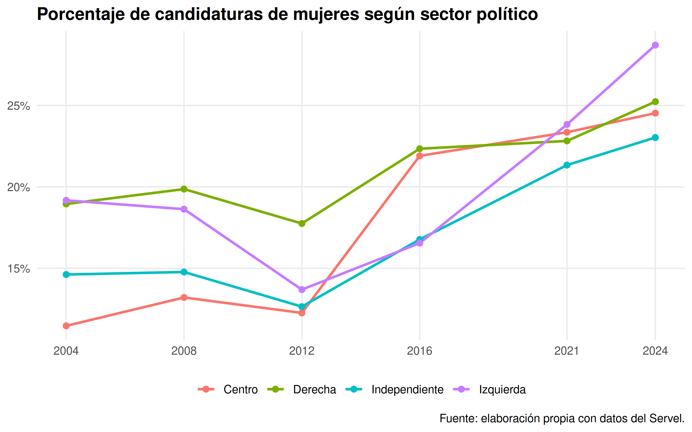
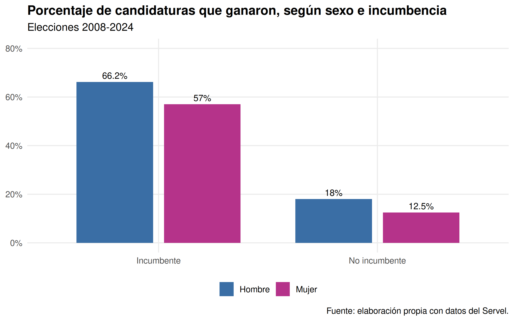
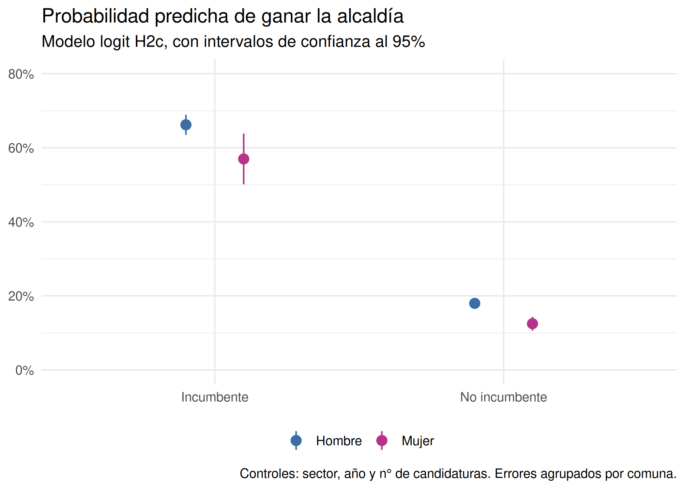

```{r setup, include=FALSE}
# Este documento usa los resultados creados por los scripts de la carpeta
# scripts/ (ejecutarlos antes en orden: 01, 02, 02b, 03 y 04).
knitr::opts_chunk$set(echo = FALSE, message = FALSE, warning = FALSE,
                      fig.width = 6.5, fig.height = 4, dpi = 300)
library(dplyr)
library(readr)
library(knitr)

base   <- read_csv("data/clean/base_alcaldes.csv", show_col_types = FALSE)
t1     <- read_csv("output/tabla1_candidaturas_alcaldias.csv", show_col_types = FALSE)
t2     <- read_csv("output/tabla2_candidatas_sector_pacto.csv", show_col_types = FALSE)
t3     <- read_csv("output/tabla3_exito_sexo_incumbencia.csv", show_col_types = FALSE)
t4     <- read_csv("output/tabla4_reeleccion_sexo.csv", show_col_types = FALSE)
t5     <- read_csv("output/tabla5_estadisticos_descriptivos.csv", show_col_types = FALSE)
mods   <- read_csv("output/tabla6_resultados_modelos.csv", show_col_types = FALSE)
p_h2   <- read_csv("output/tabla7_prob_predicha_ganar.csv", show_col_types = FALSE)
ame    <- read_csv("output/tabla8_efectos_marginales_mujer.csv", show_col_types = FALSE)
p_h3b  <- read_csv("output/tabla9_prob_predicha_reelecciones.csv", show_col_types = FALSE)
p_h2d  <- read_csv("output/tabla10_prob_ganar_alcaldesa_previa.csv", show_col_types = FALSE)

# Funciones de ayuda para escribir números en el texto
pct <- function(x, d = 1) format(round(100 * x, d), decimal.mark = ",", nsmall = d)
num <- function(x, d = 2) format(round(x, d), decimal.mark = ",", nsmall = d)
coef_de <- function(modelo, var, col = "coeficiente") {
  mods[[col]][grepl(modelo, mods$modelo, fixed = TRUE) & mods$variable == var][1]
}
```

**Repositorio con datos y código para reproducir el análisis:** https://github.com/Paz-rojas15/alcaldesas-chile

# Introducción y pregunta de investigación

<!-- Texto de la Entrega 1, con las correcciones de la profesora. Revisar y ajustar. -->

Las mujeres son más de la mitad de la población de Chile, pero siguen siendo una minoría entre quienes gobiernan las comunas del país. Desde 2004, cuando los alcaldes comenzaron a elegirse de forma directa y separada de los concejales, la gran mayoría de las alcaldías ha quedado en manos de hombres: en la elección de 2024, solo el `r t1$"% alcaldesas"[t1$Año == 2024]`% de las alcaldías fue ganada por una mujer. Este hecho lleva a preguntarse si el problema es que pocas mujeres compiten, o si, cuando compiten, se vota menos por ellas.

A partir de esto, la pregunta que guía este proyecto es: **¿Por qué hay tan pocas alcaldesas en Chile?** Para responderla, se analiza la oferta y la demanda de candidatas en las elecciones municipales de 2004 a 2024.

Esta pregunta es relevante por dos razones. En términos teóricos, permite poner a prueba una discusión que sigue abierta en la ciencia política: si la baja presencia de mujeres en cargos de elección popular se debe a que se presentan menos (oferta) o a que los votantes las prefieren menos (demanda). En términos empíricos, las alcaldías chilenas son un caso especialmente interesante, porque la ley de cuotas de género aprobada en 2015 se aplica a las elecciones parlamentarias, pero no a las municipales. Por lo tanto, permiten observar cómo cambia la representación de las mujeres cuando no existe ninguna regla que la impulse.

# Planteamiento teórico

<!-- Pegar aquí el planteamiento teórico de la Entrega 1 SIN la sección
"¿Qué pasa cuando gobiernan mujeres?" (la profesora la tachó) y ajustando
lo que haya marcado. Secciones que se mantienen:
- ¿Por qué importa que haya mujeres en el poder? (Pitkin, Phillips, Campbell y Wolbrecht)
- Oferta y demanda: dos explicaciones para la falta de mujeres
- La incumbencia: cuando los cargos casi nunca quedan libres
- El caso chileno (sin "y el aporte de este proyecto" en el título)
Sugerencia: en el párrafo sobre Beaman et al. (2009), destacar que el
sesgo de los votantes disminuye después de haber tenido una mujer en el
cargo, porque se pone a prueba en el modelo H2d. -->

[PEGAR Y AJUSTAR EL TEXTO DE LA ENTREGA 1]

# Hipótesis

- **H1 (oferta):** se presentan muchas menos mujeres que hombres como candidatas a alcalde.
- **H2 (demanda):** aun compitiendo en condiciones similares a los hombres (mismo sector político, misma condición de incumbencia y comunas con características parecidas), las candidatas obtienen menos votos y tienen una menor probabilidad de ganar. Como extensión, y siguiendo a Beaman et al. (2009), se espera que esta brecha sea menor en las comunas que ya tuvieron una alcaldesa.
- **H3 (reelección):** una vez en el cargo, las alcaldesas tienen una menor probabilidad de ser reelegidas que los alcaldes.

# 1. Datos y estrategia de análisis

**Fuentes.** La base de datos fue construida a partir de los resultados oficiales del Servicio Electoral (Servel). Para 2004, 2008, 2012 y 2016 se usó la planilla de resultados de alcaldes del Servel, que incluye el sexo de cada candidatura y si resultó electa. Para 2021 se usaron los resultados definitivos por mesa (un archivo por región), unidos a la nómina oficial de candidaturas, que contiene el sexo de cada persona. Los resultados de 2024 solo están publicados en un tablero interactivo del Servel, por lo que se obtuvieron consultando directamente los datos de ese tablero. Las características de las comunas provienen del Censo 2024 del INE (población y escolaridad) y de las estimaciones comunales de pobreza por ingresos de 2017 del Ministerio de Desarrollo Social. Todo el proceso de descarga y construcción de la base se realiza con los scripts del repositorio.

**Unidad de análisis.** Cada observación es una candidatura a alcalde o alcaldesa: una persona que compitió en una comuna en una elección. La base final contiene `r format(nrow(base), big.mark = ".", decimal.mark = ",")` candidaturas en `r length(unique(base$comuna))` comunas y seis elecciones.

**Decisiones de preparación de los datos.**

- Los votos por mesa o circunscripción se sumaron para obtener el total de cada candidatura en su comuna. Los votos blancos y nulos se excluyeron, de modo que el porcentaje de votos se calcula sobre los votos válidamente emitidos por candidaturas.
- Cabo de Hornos y Antártica eligen en conjunto a su alcalde, por lo que se trataron como una sola comuna. Se unificaron nombres de comunas escritos de forma distinta entre años (por ejemplo, Aysén y Aisén).
- En 2021, algunos nombres difieren entre el archivo de resultados y la nómina de candidaturas (tildes, segundos nombres o errores de tipeo). Se unieron buscando, dentro de cada comuna, el nombre más parecido y exigiendo que coincidieran los apellidos. Para 15 candidaturas que no aparecían en la nómina, y para 3 candidaturas de 2016 sin sexo registrado, el sexo se codificó manualmente a partir del nombre, como se había propuesto en la Entrega 1.
- En Río Claro 2016 el archivo no identifica a la persona electa, por lo que se consideró ganadora a la candidatura con más votos. En 2021 la persona electa se definió del mismo modo.
- La **incumbencia** se construyó identificando si la persona (mismos apellidos e inicial del nombre) había ganado la elección anterior en la misma comuna. Como la elección de 2000 usaba otro sistema, en 2004 la incumbencia no se puede determinar y esas observaciones quedan como valores perdidos. Por eso, los modelos de H2 y H3 usan las elecciones de 2008 a 2024.
- El **sector político** se asignó según el partido de cada candidatura (izquierda, centro o derecha). A las personas independientes que compitieron dentro de un pacto se les asignó el sector más frecuente entre los candidatos con partido de su misma lista. Las candidaturas fuera de pacto forman la categoría "Independiente", y algunos partidos regionales o sin ubicación clara, la categoría "Otro".

# 2. Operacionalización y análisis descriptivo

```{r tabla-variables}
vars <- tibble::tribble(
  ~Concepto, ~Variable, ~Medición,
  "Representación descriptiva", "% de alcaldías ganadas por mujeres", "Por elección",
  "Oferta de candidatas (H1)", "Mujer", "1 = la candidatura es de una mujer",
  "Demanda electoral (H2)", "% de votos", "% de votos válidos en la comuna (0 a 100)",
  "Demanda electoral (H2)", "Ganó", "1 = ganó la alcaldía",
  "Reelección (H3)", "Ganó, entre incumbentes", "1 = fue reelecto/a",
  "Reelección (H3)", "N° de reelecciones", "0, 1, 2 o 3 períodos consecutivos previos",
  "Control", "Incumbente", "1 = era alcalde/sa en ejercicio",
  "Control", "Sector político", "Izquierda, Centro, Derecha, Independiente (fuera de pacto), Otro",
  "Control", "Año de la elección", "2004 a 2024",
  "Control", "N° de candidaturas", "Candidaturas en la comuna",
  "Control comunal", "Población (log)", "Censo 2024",
  "Control comunal", "Escolaridad", "Años promedio, 18 años o más (Censo 2024)",
  "Control comunal", "Pobreza", "% de personas en pobreza por ingresos (2017)",
  "Control comunal", "Alcaldesa previa", "1 = la comuna tuvo alcaldesa en una elección anterior"
)
kable(vars, caption = "Tabla 1. Conceptos, variables y medición")
```

```{r tabla-descriptivos}
kable(t5, caption = "Tabla 2. Estadísticos descriptivos", format.args = list(decimal.mark = ","))
```

```{r tabla-anual}
kable(t1, caption = "Tabla 3. Candidaturas y alcaldías por elección", format.args = list(decimal.mark = ","))
```

```{r grafico1, fig.cap="Gráfico 1. Mujeres entre candidaturas y alcaldías, 2004-2024"}
include_graphics("output/grafico1_mujeres_candidaturas_alcaldias.png")
```

> **Nota para escribir (borrar antes de entregar):** las candidatas pasaron de `r num(t1$"% candidatas"[1], 1)`% en 2004 a `r num(t1$"% candidatas"[6], 1)`% en 2024; las alcaldesas, de `r num(t1$"% alcaldesas"[1], 1)`% a `r num(t1$"% alcaldesas"[6], 1)`%. En todas las elecciones el % de alcaldesas es menor que el % de candidatas.

[ESCRIBIR: descripción del Gráfico 1]

```{r grafico2, fig.cap="Gráfico 2. Candidaturas de mujeres según sector político"}

```

```{r grafico3, fig.cap="Gráfico 3. Porcentaje de candidaturas que ganaron, según sexo e incumbencia (2008-2024)"}

```

```{r grafico5, fig.cap="Gráfico 4. Reelección de alcaldes y alcaldesas"}
include_graphics("output/grafico5_reeleccion_sexo.png")
```

[ESCRIBIR: descripción de los Gráficos 2 a 4 y su relación con H1, H2 y H3]

# 3. Construcción y estimación de los modelos

Para cada hipótesis se estimó un modelo acorde al tipo de variable dependiente. En todos los casos, los errores estándar se agruparon por comuna, porque las candidaturas de una misma comuna comparten condiciones y no son observaciones independientes.

- **H1 (oferta).** Regresión logística en que la variable dependiente es si la candidatura es de una mujer, con el sector político y el año como variables independientes. Permite ver si algunos sectores, o el paso del tiempo, se asocian a una mayor presencia de candidatas.
- **H2 (demanda).** Dos modelos con el sexo de la candidatura como variable independiente principal: una regresión lineal múltiple (MCO) sobre el porcentaje de votos (H2a) y una regresión logística sobre si la candidatura ganó (H2b). Ambos controlan por incumbencia, sector, año, número de candidaturas en la comuna y características de la comuna (población, escolaridad y pobreza). Estos controles responden a las explicaciones alternativas de la literatura: la ventaja de quienes ya ocupan el cargo (Schwindt-Bayer, 2005), las diferencias entre partidos y las condiciones sociales de cada comuna. El modelo H2c agrega una interacción entre sexo e incumbencia, y el modelo H2d, entre sexo y que la comuna haya tenido una alcaldesa antes, este último solo con candidaturas no incumbentes.
- **H3 (reelección).** Una regresión logística sobre si fue reelecto/a, entre quienes buscaban la reelección (H3a), y un logit ordenado sobre el número de reelecciones consecutivas acumuladas por quienes ganaron la alcaldía (H3b), como recomendó la corrección de la Entrega 1.
- **Modelo comunal.** Para entender por qué algunas comunas eligen mujeres y otras no, se estimó un logit con cada comuna en cada elección como unidad, en que la variable dependiente es si ganó una mujer.

```{r tabla-modelos}
# Construir una tabla de regresión: coeficiente, estrellas y error estándar
etiquetas <- c(
  "mujer" = "Mujer", "incumbente" = "Incumbente", "periodos_previos" = "Períodos previos",
  "mujer:incumbente" = "Mujer × Incumbente", "alcaldesa_previa" = "Alcaldesa previa",
  "mujer:alcaldesa_previa" = "Mujer × Alcaldesa previa",
  "sectorCentro" = "Centro", "sectorDerecha" = "Derecha",
  "sectorIndependiente" = "Independiente (fuera de pacto)", "sectorOtro" = "Otro sector",
  "n_candidatos" = "N° de candidaturas", "n_candidatas" = "N° de candidatas",
  "incumbente_mujer" = "Alcaldesa en ejercicio compite",
  "log_poblacion" = "Población (log)", "escolaridad" = "Escolaridad", "pobreza" = "Pobreza (%)",
  "(Intercept)" = "Constante"
)
tabla_modelos <- function(nombres, titulos) {
  celdas <- mods %>%
    filter(modelo %in% nombres, !grepl("^anio|\\|", variable)) %>%
    mutate(signif = ifelse(is.na(signif), "", signif),
           celda = paste0(num(coeficiente, 3), signif, " (", num(error_est, 3), ")"),
           variable = ifelse(variable %in% names(etiquetas), etiquetas[variable], variable)) %>%
    select(modelo, variable, celda)
  ancho <- tidyr::pivot_wider(celdas, names_from = modelo, values_from = celda,
                              values_fill = "")
  ancho <- ancho[order(match(ancho$variable, etiquetas)), ]
  n_obs <- mods %>% filter(modelo %in% nombres) %>% group_by(modelo) %>%
    summarise(n = format(first(n), big.mark = ".", decimal.mark = ","))
  fila_n <- as.list(c("N", n_obs$n[match(nombres, n_obs$modelo)]))
  names(fila_n) <- c("variable", nombres)
  ancho <- bind_rows(ancho[, c("variable", nombres)], as_tibble(fila_n))
  names(ancho) <- c("", titulos)
  ancho
}
kable(tabla_modelos(
  c("H1: logit candidata mujer", "H2a: MCO % de votos", "H2b: logit ganó",
    "H2d: logit ganó, no incumbentes (interacción alcaldesa previa)"),
  c("H1: Mujer (logit)", "H2a: % votos (MCO)", "H2b: Ganó (logit)", "H2d: Ganó, no incumbentes (logit)")),
  caption = "Tabla 4. Modelos de oferta y demanda. Coeficientes y errores estándar agrupados por comuna entre paréntesis. Todos los modelos incluyen efectos fijos de año. *** p<0,001; ** p<0,01; * p<0,05; . p<0,1")
```

```{r tabla-modelos-2}
kable(tabla_modelos(
  c("H3a: logit reelección", "H3b: logit ordenado n° reelecciones", "Comunal: logit alcaldesa electa"),
  c("H3a: Reelecto/a (logit)", "H3b: N° reelecciones (logit ordenado)", "Comunal: Alcaldesa electa (logit)")),
  caption = "Tabla 5. Modelos de reelección y modelo comunal. Coeficientes y errores estándar agrupados por comuna entre paréntesis. Todos los modelos incluyen efectos fijos de año. *** p<0,001; ** p<0,01; * p<0,05; . p<0,1")
```

# 4. Presentación e interpretación de los resultados

```{r grafico6, fig.cap="Gráfico 5. Probabilidad predicha de ganar según sexo e incumbencia (modelo H2c)"}

```

```{r grafico7, fig.cap="Gráfico 6. Probabilidad predicha de ganar de candidaturas no incumbentes, según sexo y experiencia previa de la comuna con una alcaldesa (modelo H2d)"}
library(ggplot2)
ggplot(p_h2d, aes(Comuna, estimate, color = Sexo)) +
  geom_pointrange(aes(ymin = conf.low, ymax = conf.high),
                  position = position_dodge(0.4), size = 0.6) +
  scale_color_manual(values = c("Mujer" = "#B5338A", "Hombre" = "#3A6EA5")) +
  scale_y_continuous(labels = scales::percent, limits = c(0, 0.35)) +
  labs(x = NULL, y = "Probabilidad predicha de ganar", color = NULL) +
  theme_minimal(base_size = 11) + theme(legend.position = "bottom")
```

> **Datos clave para escribir esta sección (borrar antes de entregar; se actualizan solos si cambian los modelos):**
>
> H1: la razón de odds de 2024 respecto de 2004 es `r num(coef_de("H1:", "anio2024", "odds_ratio"))`; las candidaturas fuera de pacto tienen una razón de odds de `r num(coef_de("H1:", "sectorIndependiente", "odds_ratio"))` (p = `r num(coef_de("H1:", "sectorIndependiente", "valor_p"), 3)`). Derecha y centro no difieren significativamente de la izquierda.
>
> H2a: las mujeres obtienen `r num(abs(coef_de("H2a:", "mujer")))` puntos porcentuales menos de votos (p = `r num(coef_de("H2a:", "mujer", "valor_p"), 3)`). H2b: razón de odds de ser mujer = `r num(coef_de("H2b:", "mujer", "odds_ratio"))`; efecto marginal promedio = `r pct(ame$estimate[1])` puntos porcentuales [IC 95%: `r pct(ame$conf.low[1])`; `r pct(ame$conf.high[1])`]. Probabilidad predicha de ganar (no incumbentes): hombre `r pct(p_h2$estimate[p_h2$Sexo=="Hombre" & p_h2$Condición=="No incumbente"])`%, mujer `r pct(p_h2$estimate[p_h2$Sexo=="Mujer" & p_h2$Condición=="No incumbente"])`%. Incumbentes: hombre `r pct(p_h2$estimate[p_h2$Sexo=="Hombre" & p_h2$Condición=="Incumbente"])`%, mujer `r pct(p_h2$estimate[p_h2$Sexo=="Mujer" & p_h2$Condición=="Incumbente"])`%. La interacción mujer × incumbente no es significativa (p = `r num(coef_de("H2c:", "mujer:incumbente", "valor_p"), 3)`).
>
> H2d: en comunas que nunca tuvieron alcaldesa: hombre `r pct(p_h2d$estimate[1])`%, mujer `r pct(p_h2d$estimate[2])`%. En comunas que ya tuvieron: hombre `r pct(p_h2d$estimate[3])`%, mujer `r pct(p_h2d$estimate[4])`%. Interacción: razón de odds `r num(coef_de("H2d:", "mujer:alcaldesa_previa", "odds_ratio"))`, p = `r num(coef_de("H2d:", "mujer:alcaldesa_previa", "valor_p"), 3)`.
>
> H3a: efecto marginal de ser mujer sobre la probabilidad de reelección = `r pct(ame$estimate[2])` puntos porcentuales [IC 95%: `r pct(ame$conf.low[2])`; `r pct(ame$conf.high[2])`]. H3b: probabilidad predicha de estar en un primer período: hombres `r pct(p_h3b$estimate[1])`%, mujeres `r pct(p_h3b$estimate[2])`%.
>
> Comunal: cada candidata adicional multiplica las odds de elegir alcaldesa por `r num(coef_de("Comunal:", "n_candidatas", "odds_ratio"))`; haber tenido alcaldesa antes, por `r num(coef_de("Comunal:", "alcaldesa_previa", "odds_ratio"))`.
>
> Recordar: interpretar dirección, magnitud e incertidumbre, y relacionar cada resultado con la hipótesis y la literatura (Norris y Lovenduski; Lawless y Fox; Brooks; Dolan; Beaman et al.; Schwindt-Bayer). Posible advertencia: la menor votación de las mujeres podría reflejar que los partidos las nominan en comunas más difíciles, y no solo la preferencia de los votantes.

[ESCRIBIR: interpretación de los resultados de H1, H2, H3 y del modelo comunal]

# Conclusiones preliminares

[ESCRIBIR]

# Referencias

Beaman, L., Chattopadhyay, R., Duflo, E., Pande, R., y Topalova, P. (2009). Powerful women: Does exposure reduce bias? *The Quarterly Journal of Economics, 124*(4), 1497–1540.

Brooks, D. J. (2013). *He runs, she runs: Why gender stereotypes do not harm women candidates*. Princeton University Press.

Campbell, D. E., y Wolbrecht, C. (2006). See Jane run: Women politicians as role models for adolescents. *The Journal of Politics, 68*(2), 233–247.

Dolan, K. (2014). *When does gender matter? Women candidates and gender stereotypes in American elections*. Oxford University Press.

Franceschet, S., Piscopo, J. M., y Thomas, G. (2016). Supermadres, maternal legacies and women's political participation in contemporary Latin America. *Journal of Latin American Studies, 48*(1), 1–32.

Huddy, L., y Terkildsen, N. (1993). Gender stereotypes and the perception of male and female candidates. *American Journal of Political Science, 37*(1), 119–147.

Instituto Nacional de Estadísticas (2025). *Censo de Población y Vivienda 2024: resultados comunales*. INE.

Lawless, J. L., y Fox, R. L. (2010). *It still takes a candidate: Why women don't run for office* (Ed. rev.). Cambridge University Press.

Ministerio de Desarrollo Social y Familia (2018). *Estimaciones comunales de pobreza por ingresos 2017 (metodología SAE)*.

Norris, P., y Lovenduski, J. (1995). *Political recruitment: Gender, race and class in the British Parliament*. Cambridge University Press.

Phillips, A. (1995). *The politics of presence*. Oxford University Press.

Pitkin, H. F. (1967). *The concept of representation*. University of California Press.

Reyes-Housholder, C., y Thomas, G. (2018). Latin America's presidentas: Challenging old patterns, forging new pathways. En L. A. Schwindt-Bayer (Ed.), *Gender and representation in Latin America* (pp. 19–38). Oxford University Press.

Schwindt-Bayer, L. A. (2005). The incumbency disadvantage and women's election to legislative office. *Electoral Studies, 24*(2), 227–244.

Servicio Electoral de Chile (2022–2025). *Resultados electorales históricos: elecciones de alcaldes 2004–2024*. Servel.
