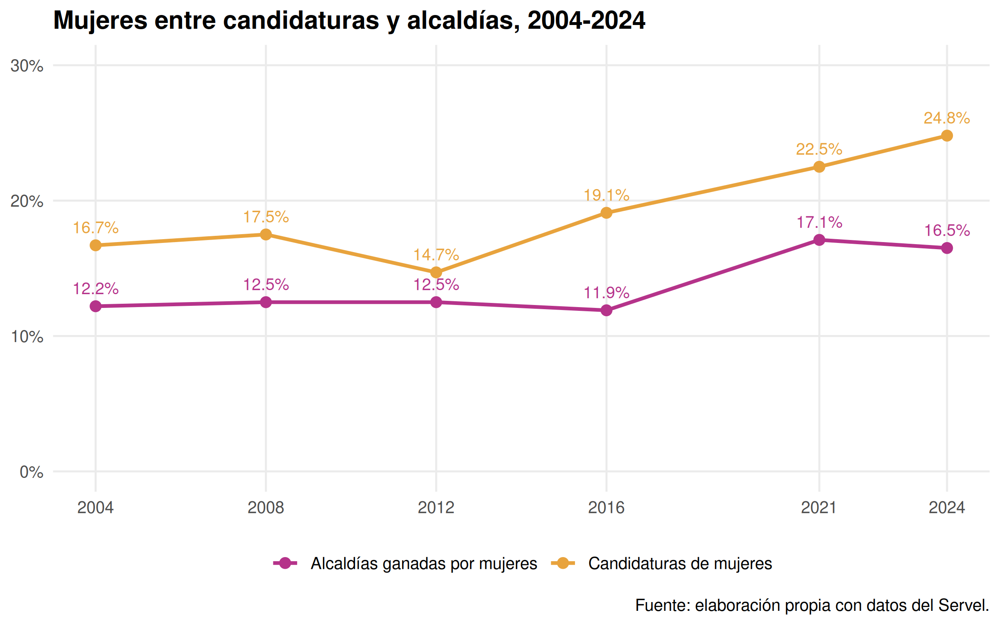
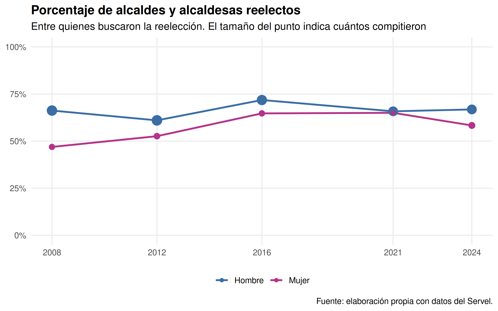

```{r setup, include=FALSE}
# Este documento usa los resultados creados por los scripts de la carpeta
# scripts/ (ejecutarlos antes en orden: 01, 02, 02b, 03 y 04).
knitr::opts_chunk$set(echo = FALSE, message = FALSE, warning = FALSE,
                      fig.width = 6.5, fig.height = 4, dpi = 300)
library(dplyr)
library(readr)
library(knitr)
library(flextable)

# Formato común de las tablas: estilo académico (líneas horizontales),
# Arial 12 y letra negra, con bordes explícitos para que se vean
# igual en Word y en Google Docs
tabla <- function(df, titulo, nota = NULL) {
  ft <- flextable(df) %>%
    theme_booktabs() %>%
    font(fontname = "Arial", part = "all") %>%
    fontsize(size = 12, part = "all") %>%
    color(color = "black", part = "all") %>%
    bold(part = "header") %>%
    set_caption(titulo) %>%
    set_table_properties(layout = "autofit", width = 1)
  if (!is.null(nota)) {
    ft <- add_footer_lines(ft, nota) %>%
      font(fontname = "Arial", part = "footer") %>%
      fontsize(size = 10, part = "footer")
  }
  ft
}

base   <- read_csv("data/clean/base_alcaldes.csv", show_col_types = FALSE)
t1     <- read_csv("output/tabla1_candidaturas_alcaldias.csv", show_col_types = FALSE)
t2     <- read_csv("output/tabla2_candidatas_sector_pacto.csv", show_col_types = FALSE)
t3     <- read_csv("output/tabla3_exito_sexo_incumbencia.csv", show_col_types = FALSE)
t4     <- read_csv("output/tabla4_reeleccion_sexo.csv", show_col_types = FALSE)
t5     <- read_csv("output/tabla5_estadisticos_descriptivos.csv", show_col_types = FALSE)
mods   <- read_csv("output/tabla6_resultados_modelos.csv", show_col_types = FALSE)
p_h2   <- read_csv("output/tabla7_prob_predicha_ganar.csv", show_col_types = FALSE)
ame    <- read_csv("output/tabla8_efectos_marginales_mujer.csv", show_col_types = FALSE)
p_h3b  <- read_csv("output/tabla9_prob_predicha_reelecciones.csv", show_col_types = FALSE)
p_h2d  <- read_csv("output/tabla10_prob_ganar_alcaldesa_previa.csv", show_col_types = FALSE)

# Funciones de ayuda para escribir números en el texto
pct <- function(x, d = 1) format(round(100 * x, d), decimal.mark = ",", nsmall = d)
num <- function(x, d = 2) format(round(x, d), decimal.mark = ",", nsmall = d)
coef_de <- function(modelo, var, col = "coeficiente") {
  mods[[col]][grepl(modelo, mods$modelo, fixed = TRUE) & mods$variable == var][1]
}
```

**Repositorio con datos y código para reproducir el análisis:** https://github.com/Paz-rojas15/alcaldesas-chile

# Introducción y pregunta de investigación

<!-- Texto de la Entrega 1, con las correcciones de la profesora. Revisar y ajustar. -->

Las mujeres son más de la mitad de la población de Chile, pero siguen siendo una minoría entre quienes gobiernan las comunas del país. Desde 2004, cuando los alcaldes comenzaron a elegirse de forma directa y separada de los concejales, la gran mayoría de las alcaldías ha quedado en manos de hombres: en la elección de 2024, solo el `r t1$"% alcaldesas"[t1$Año == 2024]`% de las alcaldías fue ganada por una mujer. Este hecho lleva a preguntarse si el problema es que pocas mujeres compiten, o si, cuando compiten, se vota menos por ellas.

A partir de esto, la pregunta que guía este proyecto es: **¿Por qué hay tan pocas alcaldesas en Chile?** Para responderla, se analiza la oferta y la demanda de candidatas en las elecciones municipales de 2004 a 2024.

Esta pregunta es relevante por dos razones. En términos teóricos, permite poner a prueba una discusión que sigue abierta en la ciencia política: si la baja presencia de mujeres en cargos de elección popular se debe a que se presentan menos (oferta) o a que los votantes las prefieren menos (demanda). En términos empíricos, las alcaldías chilenas son un caso especialmente interesante, porque la ley de cuotas de género aprobada en 2015 se aplica a las elecciones parlamentarias, pero no a las municipales. Por lo tanto, permiten observar cómo cambia la representación de las mujeres cuando no existe ninguna regla que la impulse.

# Planteamiento teórico

<!-- Texto de la Entrega 1, sin la sección que tachó la profesora. -->

## ¿Por qué importa que haya mujeres en el poder?

Para entender el problema, primero hay que definir qué significa que un grupo esté "representado". Pitkin (1967) propone una distinción que sigue siendo muy usada: la representación **descriptiva**, que se refiere a que quienes ocupan cargos se parezcan a la población que representan (por ejemplo, en su sexo), y la representación **sustantiva**, que se refiere a que defiendan los intereses de ese grupo. En este proyecto me enfoco en la representación descriptiva, es decir, en cuántas mujeres llegan a ser alcaldesas.

Esto no es solo una cuestión de números. Phillips (1995) sostiene que la presencia de mujeres en cargos de poder importa por sí misma, porque una democracia donde la mitad de la población casi no ocupa cargos de decisión está incompleta. Además, las mujeres que llegan al poder sirven como modelos a seguir: cuando las personas ven a mujeres en política, especialmente las más jóvenes, aumenta su interés por participar (Campbell y Wolbrecht, 2006).

## Oferta y demanda: dos explicaciones para la falta de mujeres

La literatura ofrece dos grandes explicaciones para entender por qué hay menos mujeres en cargos de elección popular. Norris y Lovenduski (1995) las resumen como un problema de **oferta** y de **demanda**.

Por el lado de la oferta, la explicación es que hay menos mujeres dispuestas a ser candidatas. Lawless y Fox (2010) muestran que, incluso entre personas con perfiles parecidos, las mujeres se sienten menos calificadas para competir y reciben menos invitaciones a hacerlo. A esto se suman los roles de género tradicionales y las tareas de cuidado, que les dejan menos tiempo para hacer carrera política.

Por el lado de la demanda, la explicación es que, aunque las mujeres quieran competir, el sistema no las favorece. Esto puede pasar porque los partidos prefieren nominar a hombres, o porque los votantes tienen estereotipos de género que perjudican a las candidatas, por ejemplo, la idea de que los hombres son más fuertes o mejores para liderar (Huddy y Terkildsen, 1993). En esta línea, Beaman et al. (2009) mostraron en India que los votantes evaluaban peor a las líderes mujeres, aunque ese prejuicio disminuía después de haber tenido una mujer en el cargo.

Sin embargo, otros estudios ponen en duda que los votantes castiguen a las mujeres. Brooks (2013) y Dolan (2014) encuentran que, cuando las mujeres compiten, ganan en proporciones parecidas a los hombres, y que los estereotipos de género pesan menos de lo que se pensaba. Si esto es así, el principal obstáculo no estaría en las urnas, sino antes: en que pocas mujeres llegan a ser candidatas. Esta discusión sigue abierta, y es justamente la que este proyecto busca poner a prueba en el caso chileno.

## La incumbencia: cuando los cargos casi nunca quedan libres

Existe una tercera explicación que se ubica entre las dos anteriores. Puede que las mujeres no pierdan por ser mujeres, sino porque suelen competir contra hombres que ya ocupan el cargo y buscan la reelección. Quienes están en el cargo tienen una gran ventaja: son más conocidos, tienen recursos y ya han ganado antes. Schwindt-Bayer (2005) sostiene que esta ventaja frena la llegada de mujeres, porque los cargos casi nunca quedan disponibles. Así, aunque los votantes no discriminen, la representación de las mujeres avanza muy lento.

Esta explicación es especialmente importante para Chile, donde durante años muchos alcaldes se reeligieron una y otra vez. En 2020 se aprobó un límite a la reelección de alcaldes, lo que podría haber abierto más cupos en las últimas elecciones y, con ello, más oportunidades para las mujeres. Por esta razón, la incumbencia se considerará en el análisis para comparar a hombres y mujeres en igualdad de condiciones.

## El caso chileno

En América Latina, la llegada de mujeres a la presidencia, como Michelle Bachelet en Chile, generó grandes expectativas sobre el aumento de la participación política de las mujeres (Franceschet et al., 2016; Reyes-Housholder y Thomas, 2018). Sin embargo, la mayoría de los estudios se ha concentrado en la presidencia, en el Congreso y en el efecto de las leyes de cuotas.

Las alcaldías chilenas son un caso interesante y menos estudiado por dos razones. Primero, desde 2004 los alcaldes se eligen de forma directa, lo que permite analizar veinte años de elecciones con las mismas reglas básicas. Segundo, como las elecciones municipales no tienen cuotas de género, muestran cómo cambia la representación de las mujeres sin reglas que la impulsen.

El aporte de este proyecto es analizar las elecciones de alcaldes entre 2004 y 2024 para distinguir si la baja presencia de alcaldesas se explica porque se presentan pocas mujeres, porque la ciudadanía vota menos por ellas, o porque les cuesta más mantenerse en el cargo una vez que llegan.

# Hipótesis

- **H1 (oferta):** se presentan muchas menos mujeres que hombres como candidatas a alcalde.
- **H2 (demanda):** aun compitiendo en condiciones similares a los hombres (mismo sector político, misma condición de incumbencia y comunas con características parecidas), las candidatas obtienen menos votos y tienen una menor probabilidad de ganar. Como extensión, y siguiendo a Beaman et al. (2009), se espera que esta brecha sea menor en las comunas que ya tuvieron una alcaldesa.
- **H3 (reelección):** una vez en el cargo, las alcaldesas tienen una menor probabilidad de ser reelegidas que los alcaldes.

# 1. Datos y estrategia de análisis

**Fuentes.** La base de datos fue construida a partir de los resultados oficiales del Servicio Electoral (Servel). Para 2004, 2008, 2012 y 2016 se usó la planilla de resultados de alcaldes del Servel, que incluye el sexo de cada candidatura y si resultó electa. Para 2021 se usaron los resultados definitivos por mesa (un archivo por región), unidos a la nómina oficial de candidaturas, que contiene el sexo de cada persona. Los resultados de 2024 solo están publicados en un tablero interactivo del Servel, por lo que se obtuvieron consultando directamente los datos de ese tablero. Las características de las comunas provienen del Censo 2024 del INE (población y escolaridad) y de las estimaciones comunales de pobreza por ingresos de 2017 del Ministerio de Desarrollo Social. Todo el proceso de descarga y construcción de la base se realiza con los scripts del repositorio.

**Unidad de análisis.** Cada observación es una candidatura a alcalde o alcaldesa: una persona que compitió en una comuna en una elección. La base final contiene `r format(nrow(base), big.mark = ".", decimal.mark = ",")` candidaturas en `r length(unique(base$comuna))` comunas y seis elecciones.

**Decisiones de preparación de los datos.**

- Los votos por mesa o circunscripción se sumaron para obtener el total de cada candidatura en su comuna. Los votos blancos y nulos se excluyeron, de modo que el porcentaje de votos se calcula sobre los votos válidamente emitidos por candidaturas.
- Cabo de Hornos y Antártica eligen en conjunto a su alcalde, por lo que se trataron como una sola comuna. Se unificaron nombres de comunas escritos de forma distinta entre años (por ejemplo, Aysén y Aisén).
- En 2021, algunos nombres difieren entre el archivo de resultados y la nómina de candidaturas (tildes, segundos nombres o errores de tipeo). Se unieron buscando, dentro de cada comuna, el nombre más parecido y exigiendo que coincidieran los apellidos. Para 15 candidaturas que no aparecían en la nómina, y para 3 candidaturas de 2016 sin sexo registrado, el sexo se codificó manualmente a partir del nombre, como se había propuesto en la Entrega 1.
- En Río Claro 2016 el archivo no identifica a la persona electa, por lo que se consideró ganadora a la candidatura con más votos. En 2021 la persona electa se definió del mismo modo.
- La **incumbencia** se construyó identificando si la persona (mismos apellidos e inicial del nombre) había ganado la elección anterior en la misma comuna. Como la elección de 2000 usaba otro sistema, en 2004 la incumbencia no se puede determinar y esas observaciones quedan como valores perdidos. Por eso, los modelos de H2 y H3 usan las elecciones de 2008 a 2024.
- El **sector político** se asignó según el partido de cada candidatura (izquierda, centro o derecha). A las personas independientes que compitieron dentro de un pacto se les asignó el sector más frecuente entre los candidatos con partido de su misma lista. Las candidaturas fuera de pacto forman la categoría "Independiente", y algunos partidos regionales o sin ubicación clara, la categoría "Otro".

# 2. Operacionalización y análisis descriptivo

```{r tabla-variables}
vars <- tibble::tribble(
  ~Concepto, ~Variable, ~Medición,
  "Representación descriptiva", "% de alcaldías ganadas por mujeres", "Por elección",
  "Oferta de candidatas (H1)", "Mujer", "1 = la candidatura es de una mujer",
  "Demanda electoral (H2)", "% de votos", "% de votos válidos en la comuna (0 a 100)",
  "Demanda electoral (H2)", "Ganó", "1 = ganó la alcaldía",
  "Reelección (H3)", "Ganó, entre incumbentes", "1 = fue reelecto/a",
  "Reelección (H3)", "N° de reelecciones", "0, 1, 2 o 3 períodos consecutivos previos",
  "Control", "Incumbente", "1 = era alcalde/sa en ejercicio",
  "Control", "Sector político", "Izquierda, Centro, Derecha, Independiente (fuera de pacto), Otro",
  "Control", "Año de la elección", "2004 a 2024",
  "Control", "N° de candidaturas", "Candidaturas en la comuna",
  "Control comunal", "Población (log)", "Censo 2024",
  "Control comunal", "Escolaridad", "Años promedio, 18 años o más (Censo 2024)",
  "Control comunal", "Pobreza", "% de personas en pobreza por ingresos (2017)",
  "Control comunal", "Alcaldesa previa", "1 = la comuna tuvo alcaldesa en una elección anterior"
)
tabla(vars, "Tabla 1. Conceptos, variables y medición")
```

```{r tabla-descriptivos}
tabla(t5 %>% mutate(across(where(is.numeric), ~ num(.x, 2))) %>% mutate(N = format(t5$N, big.mark = ".", decimal.mark = ",")), "Tabla 2. Estadísticos descriptivos")
```

```{r tabla-anual}
tabla(t1 %>% mutate(across(starts_with("%"), ~ num(.x, 1))) %>% mutate(Año = as.character(Año)), "Tabla 3. Candidaturas y alcaldías por elección")
```

```{r grafico1, fig.cap="Gráfico 1. Mujeres entre candidaturas y alcaldías, 2004-2024"}

```


En veinte años de elecciones, la proporción de candidatas aumentó solo 8,1 puntos porcentuales, pasando de 16,7% en 2004 a 24,8% en 2024. Este aumento se tradujo en un alza aún menor de alcaldesas electas: de 12,2% en 2004 a 16,5% en 2024, es decir, 4,3 puntos porcentuales. En 2024, aproximadamente una de cada cuatro candidaturas fue de una mujer, y solo una de cada seis alcaldías quedó en manos de una mujer. Además, en todas las elecciones el porcentaje de alcaldesas es menor que el de candidatas, lo que sugiere que la baja presencia de mujeres no se explica solo porque compitan menos.

```{r grafico2, fig.cap="Gráfico 2. Candidaturas de mujeres según sector político"}
include_graphics("output/grafico2_candidatas_por_sector.png")
```

```{r grafico3, fig.cap="Gráfico 3. Porcentaje de candidaturas que ganaron, según sexo e incumbencia (2008-2024)"}
include_graphics("output/grafico3_exito_sexo_incumbencia.png")
```

```{r grafico5, fig.cap="Gráfico 4. Reelección de alcaldes y alcaldesas"}

```

El porcentaje de candidatas es similar entre sectores políticos: 21% en la derecha, 20% en la izquierda y 17% en el centro, por lo que no hay grandes diferencias entre partidos. Sin embargo, las mujeres ganan con menos frecuencia: entre quienes no eran alcaldes en ejercicio, ganó el 18% de los hombres y solo el 12,5% de las mujeres. Además, los hombres suelen ser más reelegidos que las mujeres: entre quienes buscaron la reelección, lo logró el 66% de los alcaldes y el 57% de las alcaldesas.

# 3. Construcción y estimación de los modelos

Para cada hipótesis se estimó un modelo acorde al tipo de variable dependiente. En todos los casos, los errores estándar se agruparon por comuna, porque las candidaturas de una misma comuna comparten condiciones y no son observaciones independientes.

- **H1 (oferta).** Regresión logística en que la variable dependiente es si la candidatura es de una mujer, con el sector político y el año como variables independientes. Permite ver si algunos sectores, o el paso del tiempo, se asocian a una mayor presencia de candidatas.
- **H2 (demanda).** Dos modelos con el sexo de la candidatura como variable independiente principal: una regresión lineal múltiple (MCO) sobre el porcentaje de votos (H2a) y una regresión logística sobre si la candidatura ganó (H2b). Ambos controlan por incumbencia, sector, año, número de candidaturas en la comuna y características de la comuna (población, escolaridad y pobreza). Estos controles responden a las explicaciones alternativas de la literatura: la ventaja de quienes ya ocupan el cargo (Schwindt-Bayer, 2005), las diferencias entre partidos y las condiciones sociales de cada comuna. El modelo H2c agrega una interacción entre sexo e incumbencia, y el modelo H2d, entre sexo y que la comuna haya tenido una alcaldesa antes, este último solo con candidaturas no incumbentes.
- **H3 (reelección).** Una regresión logística sobre si fue reelecto/a, entre quienes buscaban la reelección (H3a), y un logit ordenado sobre el número de reelecciones consecutivas acumuladas por quienes ganaron la alcaldía (H3b), como recomendó la corrección de la Entrega 1.
- **Modelo comunal.** Para entender por qué algunas comunas eligen mujeres y otras no, se estimó un logit con cada comuna en cada elección como unidad, en que la variable dependiente es si ganó una mujer.

```{r tabla-modelos}
# Construir una tabla de regresión: coeficiente, estrellas y error estándar
etiquetas <- c(
  "mujer" = "Mujer", "incumbente" = "Incumbente", "periodos_previos" = "Períodos previos",
  "mujer:incumbente" = "Mujer × Incumbente", "alcaldesa_previa" = "Alcaldesa previa",
  "mujer:alcaldesa_previa" = "Mujer × Alcaldesa previa",
  "sectorCentro" = "Centro", "sectorDerecha" = "Derecha",
  "sectorIndependiente" = "Independiente (fuera de pacto)", "sectorOtro" = "Otro sector",
  "n_candidatos" = "N° de candidaturas", "n_candidatas" = "N° de candidatas",
  "incumbente_mujer" = "Alcaldesa en ejercicio compite",
  "log_poblacion" = "Población (log)", "escolaridad" = "Escolaridad", "pobreza" = "Pobreza (%)",
  "(Intercept)" = "Constante"
)
tabla_modelos <- function(nombres, titulos) {
  celdas <- mods %>%
    filter(modelo %in% nombres, !grepl("^anio|\\|", variable)) %>%
    mutate(signif = ifelse(is.na(signif), "", signif),
           celda = paste0(num(coeficiente, 3), signif, " (", num(error_est, 3), ")"),
           variable = ifelse(variable %in% names(etiquetas), etiquetas[variable], variable)) %>%
    select(modelo, variable, celda)
  ancho <- tidyr::pivot_wider(celdas, names_from = modelo, values_from = celda,
                              values_fill = "")
  ancho <- ancho[order(match(ancho$variable, etiquetas)), ]
  n_obs <- mods %>% filter(modelo %in% nombres) %>% group_by(modelo) %>%
    summarise(n = format(first(n), big.mark = ".", decimal.mark = ","))
  fila_n <- as.list(c("N", n_obs$n[match(nombres, n_obs$modelo)]))
  names(fila_n) <- c("variable", nombres)
  ancho <- bind_rows(ancho[, c("variable", nombres)], as_tibble(fila_n))
  names(ancho) <- c("Variable", titulos)
  ancho
}
tabla(tabla_modelos(
  c("H1: logit candidata mujer", "H2a: MCO % de votos", "H2b: logit ganó",
    "H2d: logit ganó, no incumbentes (interacción alcaldesa previa)"),
  c("H1: Mujer (logit)", "H2a: % votos (MCO)", "H2b: Ganó (logit)", "H2d: Ganó, no incumbentes (logit)")),
  "Tabla 4. Modelos de oferta y demanda",
  nota = "Coeficientes y errores estándar agrupados por comuna entre paréntesis. Todos los modelos incluyen efectos fijos de año. *** p<0,001; ** p<0,01; * p<0,05; . p<0,1")
```

```{r tabla-modelos-2}
tabla(tabla_modelos(
  c("H3a: logit reelección", "H3b: logit ordenado n° reelecciones", "Comunal: logit alcaldesa electa"),
  c("H3a: Reelecto/a (logit)", "H3b: N° reelecciones (logit ordenado)", "Comunal: Alcaldesa electa (logit)")),
  "Tabla 5. Modelos de reelección y modelo comunal",
  nota = "Coeficientes y errores estándar agrupados por comuna entre paréntesis. Todos los modelos incluyen efectos fijos de año. El modelo H3b excluye el sector «Otro», que tiene solo una persona electa. *** p<0,001; ** p<0,01; * p<0,05; . p<0,1")
```

# 4. Presentación e interpretación de los resultados

```{r grafico6, fig.cap="Gráfico 5. Probabilidad predicha de ganar según sexo e incumbencia (modelo H2c)"}
include_graphics("output/grafico6_prob_predicha_ganar.png")
```

```{r grafico7, fig.cap="Gráfico 6. Probabilidad predicha de ganar de candidaturas no incumbentes, según sexo y experiencia previa de la comuna con una alcaldesa (modelo H2d)"}
library(ggplot2)
ggplot(p_h2d, aes(Comuna, estimate, color = Sexo)) +
  geom_pointrange(aes(ymin = conf.low, ymax = conf.high),
                  position = position_dodge(0.4), size = 0.6) +
  scale_color_manual(values = c("Mujer" = "#B5338A", "Hombre" = "#3A6EA5")) +
  scale_y_continuous(labels = scales::percent, limits = c(0, 0.35)) +
  labs(x = NULL, y = "Probabilidad predicha de ganar", color = NULL) +
  theme_minimal(base_size = 11) + theme(legend.position = "bottom")
```

Los resultados apoyan H1. En todo el período, cerca de una de cada cinco candidaturas fue de una mujer, y el modelo H1 muestra que esta baja presencia es similar en todos los sectores políticos, porque ni el centro ni la derecha se diferencian significativamente de la izquierda. La única excepción son las candidaturas independientes fuera de pacto, donde la probabilidad de que la candidatura sea de una mujer es levemente menor. Es decir, la escasez de candidatas no es un problema de un sector en particular, sino del sistema político en su conjunto.

Los resultados también apoyan H2. Aun controlando por incumbencia, sector, año y características de la comuna, las candidatas obtienen 1,7 puntos porcentuales menos de votos y tienen una probabilidad significativamente menor de ganar que los hombres. Según el modelo H2c, esta brecha se mantiene tanto entre quienes no ocupan el cargo (18% frente a 12%) como entre quienes buscan la reelección (61% frente a 50%). Sin embargo, en línea con Beaman et al. (2009), la desventaja desaparece en las comunas que ya tuvieron una alcaldesa. Ahí, hombres y mujeres no incumbentes tienen una probabilidad de ganar casi idéntica, cercana al 16%. Estos resultados contrastan con Brooks (2013) y Dolan (2014), quienes no encuentran que los votantes castiguen a las candidatas.

Una vez en el cargo, las alcaldesas tienen 10 puntos porcentuales menos de probabilidad de ser reelegidas que los alcaldes, y esta diferencia es estadísticamente significativa. El logit ordenado confirma este resultado: las mujeres que llegan a la alcaldía acumulan menos reelecciones consecutivas que los hombres. Por último, el modelo comunal muestra que la oferta es clave para el resultado final: cada candidata adicional en una comuna multiplica por casi cuatro las probabilidades de que gane una mujer.

# Conclusiones preliminares

La baja presencia de alcaldesas en Chile se explica por varios factores combinados. Se presentan pocas mujeres, las que compiten tienen menos probabilidad de ganar que los hombres en condiciones similares y, una vez en el cargo, les cuesta más ser reelegidas. La oferta parece ser el factor más determinante, ya que cada candidata adicional en una comuna aumenta fuertemente las probabilidades de que gane una mujer. Al mismo tiempo, que la brecha desaparezca en las comunas que ya tuvieron una alcaldesa sugiere que el prejuicio de los votantes puede reducirse con la experiencia. Por eso, aumentar el número de candidatas podría tener efectos que se refuerzan en el tiempo.

# Referencias

Beaman, L., Chattopadhyay, R., Duflo, E., Pande, R., y Topalova, P. (2009). Powerful women: Does exposure reduce bias? *The Quarterly Journal of Economics, 124*(4), 1497–1540.

Brooks, D. J. (2013). *He runs, she runs: Why gender stereotypes do not harm women candidates*. Princeton University Press.

Campbell, D. E., y Wolbrecht, C. (2006). See Jane run: Women politicians as role models for adolescents. *The Journal of Politics, 68*(2), 233–247.

Dolan, K. (2014). *When does gender matter? Women candidates and gender stereotypes in American elections*. Oxford University Press.

Franceschet, S., Piscopo, J. M., y Thomas, G. (2016). Supermadres, maternal legacies and women's political participation in contemporary Latin America. *Journal of Latin American Studies, 48*(1), 1–32.

Huddy, L., y Terkildsen, N. (1993). Gender stereotypes and the perception of male and female candidates. *American Journal of Political Science, 37*(1), 119–147.

Instituto Nacional de Estadísticas (2025). *Censo de Población y Vivienda 2024: resultados comunales*. INE.

Lawless, J. L., y Fox, R. L. (2010). *It still takes a candidate: Why women don't run for office* (Ed. rev.). Cambridge University Press.

Ministerio de Desarrollo Social y Familia (2018). *Estimaciones comunales de pobreza por ingresos 2017 (metodología SAE)*.

Norris, P., y Lovenduski, J. (1995). *Political recruitment: Gender, race and class in the British Parliament*. Cambridge University Press.

Phillips, A. (1995). *The politics of presence*. Oxford University Press.

Pitkin, H. F. (1967). *The concept of representation*. University of California Press.

Reyes-Housholder, C., y Thomas, G. (2018). Latin America's presidentas: Challenging old patterns, forging new pathways. En L. A. Schwindt-Bayer (Ed.), *Gender and representation in Latin America* (pp. 19–38). Oxford University Press.

Schwindt-Bayer, L. A. (2005). The incumbency disadvantage and women's election to legislative office. *Electoral Studies, 24*(2), 227–244.

Servicio Electoral de Chile (2022–2025). *Resultados electorales históricos: elecciones de alcaldes 2004–2024*. Servel.
